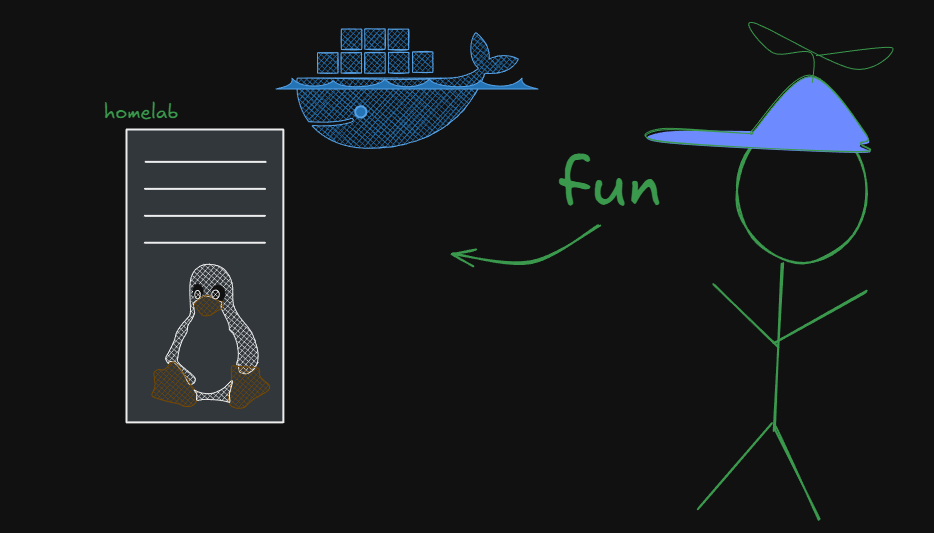
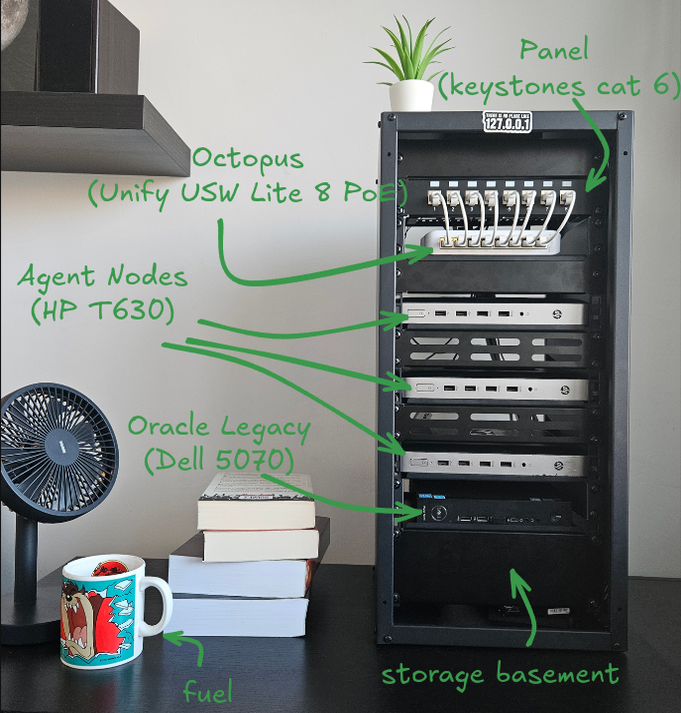

# [ k C n ]  :material-home:  homelab  

  
  
  
  

> "The cloud is just someone else's computer" – Ancient IT Proverb

## :material-link: Quick Links

* [:fontawesome-solid-chart-line: **Service Status**](https://status.kcn333.com)
* [:fontawesome-brands-github: **HomeLab K3S Cluster Repository**](https://github.com/kCn3333/k3s-homelab)
* [:material-web: **My Home Page**](https://kcn333.com)

---

## :material-information-outline: What's This All About?

Hello and welcome! This is my personal homelab documentation – a living knowledge base where I'm trying to document everything from infrastructure setup to those 3 AM debugging sessions that teach you *way* too much about Docker networking.

## :material-help-circle-outline: Why Self-Host?

**Reasons I run a homelab:**

1. **Fun** – Because it's actually so enjoyable
2. **Curiosity** - It's amazing to see how things work
3. **Learning** – Best way to understand infrastructure
4. **Privacy** – My data stays on my hardware
5. **Control** – I decide when things update (or break)
6. **Cost** – Cloud bills add up fast, even faster than electricity ones

---

## :material-server-network: My Setup

**:simple-proxmox: Hypervisor** — Proxmox VE server running LXC containers and VMs (with Docker)
**:simple-kubernetes: Kubernetes** — 3-node HA K3s with embedded etcd, Cilium and Flux GitOps, bare-metal provisioning via PXE and MAAS
**:material-source-branch: CI/CD** — Spring Boot → Git → GitHub Actions → Flux  → Helm deployment
**:material-chart-line: Observability** — Grafana, Prometheus, Loki and Alloy
**:material-code-braces: IaC** — Ansible + Semaphore, Terraform (for cloud)
**:material-backup-restore: Backup** — Proxmox Backup Server, Kopia, Garage (S3) and MEGA

  

## :material-folder-open-outline: Documentation Sections

- **:material-server-network: Infrastructure** - :material-server: Hardware setup, :material-server-network-outline: network configuration
- **:material-package-down: Provisioning** - :simple-virtualbox: VM and :simple-linux: bare-metal deployment workflows
- **:material-shield-search: Pentesting** - :material-shield-search: Lab building and :simple-hackthebox: Hack The Box write-ups
- **:material-apps: Applications** - :simple-docker: Docker compose, :simple-kubernetes: k8s manifests, :material-cog: service configs
- **:material-cog-sync-outline: Automation** - :material-ansible: Playbooks, :simple-n8n: workflows, infrastructure as code
- **:material-wrench-outline: Troubleshooting** - :material-head-lightbulb: Common issues and their solutions

 

---  

